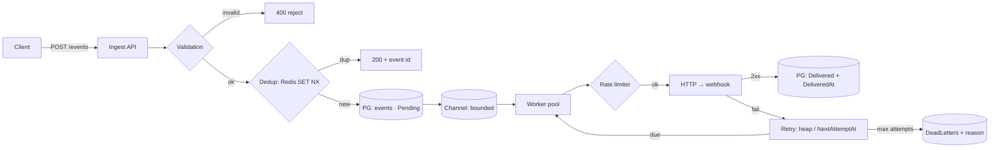

# PLAN — data flow & decision journal

> Filled in before each stage (see AGENTS.md).

## Event data flow

Key principle: an event becomes **unlosable** at the moment it is
written to Postgres (stage `DB`). Before that it is either rejected
to the client (400) or not yet accepted (no 202 — the client retries).
After the write it is our responsibility until `Delivered` or
`DeadLettered`.

## Duplicate / loss map by stage (design-time)

| Stage | Duplicate possible? | Loss possible? | Why |
| --- | --- | --- | --- |
| HTTP ingest → validation | repeated client POST | no — without a 202 the event is "not accepted", the client retries | loss only counts after acceptance |
| Dedup (Redis SET NX) | yes — after TTL window expires or with a different key | on Redis-down: depends on fail-open/fail-closed policy | Redis is a fast filter, not truth |
| PG write | no — unique index on IdempotencyKey | edge: SET NX succeeded but insert didn't → client retry is cut as a dup while no row exists (resolved: insert-first) | the index is the hard boundary |
| Channel (in-memory) | no | no — the channel item can be lost, but the event is already in PG; only delayed until the sweeper picks up `Status=Pending` | queue is transport, not storage |
| Worker → send | yes — endpoint got it, worker died before writing ack → retry | no — a failure goes to retry | legitimate at-least-once duplicate |
| Retry heap | no | on restart if heap were memory-only | PG scan is truth; heap is an accelerator |
| DLQ | replay can produce a dup (acceptable) | no — terminal, but queryable and replayable | quarantine, not a trash bin |

## Metrics (TASK-009 — selected)

| Metric | Which failure/degradation it shows |
| --- | --- |
| `dedup.hit_ratio` (dup/accepted) | spike in client resubmits; a drop → cache blown / Redis down |
| `queue.depth` (Pending+InFlight+RetryScheduled) | growth → delivery lags behind ingest; 503 at the ceiling |
| `delivery.duration_ms` (p50/p95) | receiver endpoint degrading before 5xx appear |
| `delivery.retry_rate` | share of events on retries — a down endpoint or our bug |
| `dlq.size` (live) | silent death of events; growth → the reason field explains |
| `sweeper.stale_reclaims` | workers dying/hanging — lease fires too often |
| `latency.to_ack` (CreatedAt→DeliveredAt) | end-to-end system latency, the SLO metric |

## Decision journal

| Date | Decision | Context / why |
| --- | --- | --- |
| 2026-10-16 | Ingest order: validate → dedup → PG → queue → 202 | v1 (queue → dedup → validate → DB) rejected: event in memory before the write = a loss window; dups eat channel capacity; the unique index catches duplicate inserts anyway |
| 2026-10-16 | Client response: `202 Accepted` + event id, only after the PG write | 202 = "accepted, will deliver"; the id lets the client poll status |
| 2026-10-16 | Invalid input → 400, not DLQ | DLQ is for accepted-but-undeliverable; garbage is the client's to fix |
| 2026-10-16 | Ack = `Status=Delivered` + `DeliveredAt` after 2xx | until ack the event must live somewhere in the system |
| 2026-10-16 | On endpoint 500/timeout — automatic retry (not just a log) | logs are for people; retry is system behaviour, see TASK-005 |
| 2026-10-16 | Dedup key = SHA256(webhookId + payload) | without webhookId the same payload to different webhooks would collapse into one key — user's decision |
| 2026-10-16 | Dup response: `200` + original event id + duplicate flag | the client gets an idempotent answer and can query event status — user's decision |
| 2026-10-16 | Redis-down during dedup: fail-open (pass through) | the PG unique index catches the dup on insert anyway — Redis is only a fast filter; fail-closed would cut availability with no correctness gain |
| 2026-10-16 | Dedup order: insert into PG → then SET NX in Redis | the insert itself rejects dups via the index; closes the "SET succeeded, died before insert" edge |
| 2026-10-16 | Dedup window TTL: 24h (configurable) | Stripe's idempotency keys live 24h; the window is the horizon of late client retries, not network delay |
| 2026-10-17 | Insert-first confirmed by user | PG index = source of truth, Redis = fast-path cache |
| 2026-10-17 | Redis-down → fail-open, confirmed | the PG index catches dups regardless; cost — extra insert attempts while Redis is down |
| 2026-10-17 | Sweeper is mandatory | scans `Pending`, picks up "in PG but never reached the channel" (restart, overflow); gentle — batches + interval |
| 2026-10-17 | Overflow: variant D with a ceiling | always insert into PG + 202; reject 503 only when `Pending` > threshold (config). PG = the real queue, channel = fast path. The ceiling protects the table from bloat |
| 2026-10-17 | Channel capacity ~10k | buffer for producer/consumer skew; ~10s of burst with delivery stalled |
| 2026-10-17 | Rate-limit delay and retry — ONE mechanism of deferred send | a sleeping worker blocks other events (head-of-line); a delay is a schedule, not a sleep |
| 2026-10-17 | Backoff: max 5 attempts; base 1s, ×2, cap 5min — confirmed | user confirmed the defaults |
| 2026-10-18 | Checkpoint TASK-002/003 — partial (delegated) | user correctly found fail-open, lease-by-UpdatedAt, retryable codes; the race is resolved by the PG index (not Redis) — answered by Devin; "died before SaveChanges" → receiver-side dup, no loss |
| 2026-10-17 | TASK-004/005 — hands-on mode: Devin mentors only | learning tickets, pure algorithms |
| 2026-10-19 | Checkpoint Q1 — correct; Q2 (why depth counts all statuses) — open, deferred | user's answers recorded honestly |
| 2026-10-19 | TASK-006 endpoints delegated to Devin; DLQ semantics — user review | fatigue, explicit "do it yourself" |
| 2026-10-19 | P-05 SignalR feed: worker publishes status after SaveChanges; feed errors are swallowed — observability must not block delivery | platform, delegated |
| 2026-10-19 | D15 architectural style: modular monolith, Core/Infrastructure/Api; not microservices, not layered cake — rationale in architecture.md | user asked to "record why" |
| 2026-10-19 | P-06 dashboard + `GET /stats`; vite proxy → :5269, no CORS; npm scripts via `node ...` because of a space in the path | platform, delegated |
| 2026-10-20 | P-07 LoadGen (rps/burst/dup); dashboard in compose behind nginx proxy; P-02 closed without IRepository per D15 | platform, delegated |
| 2026-10-21 | D16 bucket capacity = RateLimitPerSecond (one second of burst); jitter = equal (`delay/2 + rand(delay/2)`) | user's choice; equal is stabler — guaranteed lower half bound |
| 2026-10-21 | Checkpoint: Q3/Q6/T1 talked through, partial — explanations recorded (atomic claim; dedup TTL vs PG-forever; ingest-dup vs send-dup) | user answered at 2am, recorded honestly |
| 2026-10-24 | TASK-004 written by user — logic correct; fixed duplicate stub methods, epsilon at token boundary; tests delegated to Devin (6 green) | hands-on done |
| 2026-10-24 | Enqueue race (Q3) fixed by atomic claim `Pending→InFlight` in ingest and sweeper; rollback on full channel | edge from guide.md |
| 2026-10-24 | Limiter wired: `TokenBucketRateLimiter` (ConcurrentDictionary, D6/L1) + worker defers by wait via RetryScheduled (D7) | delegated |
| 2026-10-24 | TASK-008 `ConsistentHashRing` implemented (delegated), not wired into the system — waits for multi-instance | reviewed 26.10 |
| 2026-10-24 | `/metrics`: EngineMetrics counters + DB-derived (depth, dlq_live, ratios); `/health` → readiness PG+Redis | TASK-009 |
| 2026-10-24 | D14 implemented: HMAC-SHA256 body signature (`X-Webhook-Signature`); worker sends `webhook.Secret`; `MockReceiver` in compose + signature logging; `Delivery:WorkerParallelism` | platform |
| 2026-10-25 | Redis fail-open closed at the DI boundary: `abortConnect=false` — a dead Redis no longer kills ingest at resolution | guarantee |
| 2026-10-25 | TASK-005 (delegated): `BackoffPolicy` exp·2^a + equal jitter + 5min cap + max 5; `HeapRetryScheduler` — versioned lazy deletion; worker: max-attempts → DLQ, schedule after SaveChanges; sweeper: heap fast-path + PG scan (truth) | defended by user 25–26.10 (S1–S5) |
| 2026-10-25 | Dev model fixed: Kanban + XP solo (AGENTS) | process |
| 2026-10-25 | `GET /webhooks`, `GET /events`, `GET /events/{id}` (+attempts), `DELETE /received` on MockReceiver — read side closed | platform |
| 2026-10-17 | Non-retryable: 4xx (except 429), bad payload, deactivated webhook | rule: "would a retry change the answer?" no → don't retry |
| 2026-10-17 | DLQ conditions: retries exhausted / non-retryable error / invalid payload post-accept / webhook deactivated | invalid at the door stays a 400, not DLQ |
| 2026-10-17 | Replay bypasses dedup (the same key would be eaten by the filter) | status→Pending, attempt history kept as audit |
| 2026-10-17 | MVP without client Idempotency-Key (content-hash); header — an evolution | user asked "who needs it" — clients with their own event ids; deferred |
| 2026-10-25 | TASK-010 EXPLAIN on 4806 rows: due-scan and stale-scan both ride `IX_Events_Status_NextAttemptAt` (0.07ms/0.02ms); **L4 resolved — keep the full index**: a partial on (0,2) would break stale-scan into seq scan, and the 80kB→~2kB saving is negligible; a second partial = write amplification for no reason | delegated to Devin, accepted |
| 2026-10-25 | depth `COUNT(Status IN 0,1,2)` — Index Only Scan over the live subtrees only (delivered rows sit in a different key branch) → cost bounded by live work, not table size; the earlier "hot COUNT" worry removed by data | delegated |
| 2026-10-25 | `NextAttemptAt = CreatedAt` instead of NULL — deferred: OR+Filter in due-scan already rides the index at 0.07ms; the trick would give a clean range but costs the "null = now" semantics that already works | delegated, low value |
| 2026-10-25 | `/stats` = Seq Scan + HashAggregate (0.7ms at 5k; ~300ms at 1M rows every 2s — a real growth point) | closed by `StatsCache` on 2026-10-26 |
| 2026-10-26 | `StatsCache` (singleton, TTL 3s, SemaphoreSlim + double-check): `/stats` and `/metrics` share one snapshot → at most one seq-scan per poll tick instead of per request | platform, verified in full compose run |
| 2026-10-26 | Full 5-service compose verified: event → api → PG → worker → mockreceiver over internal DNS with HMAC; LoadGen 1000@100rps → 804 delivered, 0 err; nginx proxies all routes incl. SignalR upgrade | P-03 done |
| 2026-10-26 | Config tuned to local-optimal (not prod-recommended): Sweeper interval 10→2s so 1/2/4/8s backoff fires on plan; PendingThreshold 100k→10k so backpressure is observable locally; prod direction documented in guide.md | platform |
| 2026-10-28 | H-1 design locked (user dictation): `TimeProvider` into `IngestEvent`; **rolling** dedup = Redis `SET NX EX window` on `sha256(wh+payload)` (rolling by TTL from first sight) + PG backstop `sha256(wh+payload+bucket)` (unique index can't be time-relative); `WindowHours<=0` → clamp to 1; `bucket` as `ComputeKey` param (`long?` — null gives the Redis content key). Open: Redis-hit path needs the original `eventId` — value-in-Redis vs `ContentHash` column, picked at write time | user's choice; rolling chosen over fixed to close the boundary straddle |

## Failure-boundary map: where duplicates, where loss (proven live)

The project's final criterion — every row backed by a live run
(evidence: done-log table of 9 failures; three LoadGen runs —
2,055 / ~4,800 / 803 accepted events).

| Stage | Duplicate possible? | Loss possible? | Mechanism / guard | Evidence |
| --- | --- | --- | --- | --- |
| POST /events, PG down | no | **no** — client gets a 5xx, not a 202 | honest refusal before accept | chaos #1: HTTP 500 |
| POST /events, Redis down | no | no | fail-open → PG unique `IdempotencyKey` catches the dup | chaos #2: 2nd POST = duplicate with Redis dead |
| Ack after commit, client never heard it | **yes** — client retries → a dup on our ingest | no | client sees a timeout, but the event is in PG; client retry → `duplicate` response, not a second event | T5 analysed |
| Redis TTL expired, same key | no | no | PG unique is permanent (Q8 — accepted) | chaos #9: TTL=0 → still duplicate |
| Claim → channel (channel full) | no | no | `Pending` stays in PG, sweeper picks it up next tick | chaos #4: cap=1, 3/3 delivered |
| Worker died after claim, before send | no | no | `InFlightTimeout` lease → sweeper reclaim → re-enqueue | chaos #7 reclaim stage |
| Send succeeded, ack/status never written (crash) | **yes** — reclaim → repeated send | no | at-least-once: a dup is legal, loss is not | Q7: two attempt#1 rows observed live |
| Slow channel > lease (Q7) | **yes** — a second worker sends in parallel | no | accepted as a boundary; the fix — lease versioning (hands-on task H-3) | chaos #7: attemptCount=2 across 3 sends |
| Retry in heap, process killed | no | no | `NextAttemptAt` in PG is truth; the heap is an accelerator, rebuilt by scan | chaos #3: retries continued after kill |
| Endpoint always 500 | no | **no — quarantine, not loss** | MaxAttempts → DLQ + `DeadLetterItem.Reason` | chaos #5: 5 attempts → DLQ |
| Endpoint flaps 500↔200 | yes (a retry is a repeated send by design) | no | equal-jitter backoff: a chance at 200 within 5 attempts | chaos #6: [500,200] → Delivered |
| Replay from DLQ | by operator's will (not a failure) | no | bypasses dedup, AttemptCount→0, history kept as audit | chaos #8: second delivery cycle |
| Client resends with a new body | no | no | different content-hash = different key = a new event (correct) | by construction |

**Bottom line:** no loss on any stage after accept (202) — the only
"refusal" before accept honestly returns a 5xx. Failure-caused
duplicates live on three boundaries — client retry after a lost
ack, crash between send and ack write, slow channel past the lease
(Q7) — all legal under at-least-once. Flap retries and DLQ replay are
repeated sends by design, not failures. The only "dirty" dup is Q7
(documented).

## Open questions

- With a content-hash key, "the same event 25h later" is still caught
  by the PG index. Do we want to distinguish "a resend of the same
  submission" vs "a genuinely new event with the same body"? Needs a
  client-supplied Idempotency-Key header — an evolution, not MVP
- ~~Deferred retries: heap on restart~~ ✓ resolved: PG scan is truth,
  heap is an accelerator (TASK-005)
- ~~Webhook signing~~ ✓ done: `X-Webhook-Signature` (D14)
- ~~**L4**~~ ✓ resolved by data (2026-10-25): keep the full index —
  both hot scans ride it; a partial would break stale-scan.
  See the journal above
