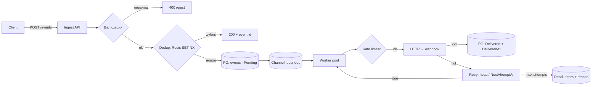

# PLAN — data flow и журнал решений

> Заполняется вручную перед каждой стадией (см. AGENTS.md).

## Data flow события

Ключевой принцип: событие становится **непотеряемым** в момент записи
в Postgres (стадия `DB`). До этого оно либо отвергнуто клиенту (400),
либо ещё не принято (нет 202 — клиент ретраит). После записи — наша
ответственность до `Delivered` или `DeadLettered`.

## Карта «дубль / потеря» по стадиям

| Стадия | Дубль возможен? | Потеря возможна? | Почему |
| --- | --- | --- | --- |
| HTTP приём → валидация | повторный POST клиента | нет — без 202 событие «не принято», клиент ретраит | потеря считается только после принятия |
| Dedup (Redis SET NX) | да — после истечения TTL-окна или при другом ключе | при Redis-down: зависит от политики fail-open/fail-closed (открытый вопрос) | Redis — быстрый фильтр, не истина |
| Запись в PG | нет — unique-индекс на IdempotencyKey | край: SET NX успел, insert нет → повтор клиента отсекается как дубль, а записи не было (открытый вопрос) | индекс — жёсткая граница |
| Channel (in-memory) | нет | да — но событие уже в PG, восстановление по Status=Pending | очередь — транспорт, не хранилище |
| Worker → отправка | да — endpoint получил, воркер умер до записи ack → ретрай | нет — фейл уходит на ретрай | допустимый дубль at-least-once |
| Retry heap | нет | при рестарте, если heap только в памяти (открытый вопрос) | нужна стратегия восстановления |
| DLQ | replay может дать дубль (допустимо) | нет — терминально, но читаемо и replayable | карантин, не мусорка |

## Журнал решений

| Дата | Решение | Контекст / почему |
| --- | --- | --- |
| 2026-10-16 | Порядок приёма: валидация → dedup → PG → очередь → 202 | v1 (очередь → dedup → валидация → БД) отклонён: событие в памяти до записи = окно потери; дубли жрут ёмкость канала; unique-индекс и так ловит повторные записи |
| 2026-10-16 | Ответ клиенту: `202 Accepted` + event id, только после записи в PG | 202 = «приняли, доставим»; id нужен клиенту для статуса в кабинете |
| 2026-10-16 | Невалидное на входе → 400, не в DLQ | DLQ — для принятых, но недоставленных; мусор чинит клиент |
| 2026-10-16 | Ack = `Status=Delivered` + `DeliveredAt` после 2xx | до ack событие обязано быть где-то в системе |
| 2026-10-16 | При 500/timeout от endpoint'а — авто-ретрай (не только лог) | логи для людей, ретрай — поведение системы; см. TASK-005 |
| 2026-10-16 | Ключ дедупа = SHA256(webhookId + payload) | без webhookId одинаковый payload для разных webhook'ов слился бы в один ключ — решение юзера |
| 2026-10-16 | Ответ на дубль: `200` + исходный event id + флаг duplicate | клиент получает idempotent-ответ и может спросить статус события — решение юзера |
| 2026-10-16 | Redis-down при dedup: fail-open (пропускаем дальше) | unique-индекс PG всё равно ловит дубль при insert — Redis лишь быстрый фильтр; fail-closed резал бы доступность без выигрыша в корректности |
| 2026-10-16 | Dedup-порядок: insert в PG → затем SET NX в Redis | insert сам отсекает дубли индексом; закрывает край «SET успел, умер до insert» |
| 2026-10-16 | TTL окна дедупа: 24ч (конфигурируемо) | ориентир — Stripe: их idempotency-ключи живут 24ч; окно = горизонт поздних ретраев клиента, не сетевая задержка |

## Открытые вопросы

- С content-hash ключом «то же событие через 25ч» всё ещё ловится
  PG-индексом. Хотим ли различать «повтор той же отправки» vs «новое
  событие с тем же телом»? Нужен клиентский Idempotency-Key header —
  эволюция, не MVP
- Отложенные ретраи: in-memory heap теряется при рестарте → добирать
  сканом `NextAttemptAt` из PG? — решить в TASK-005
- Подпись webhook'ов (HMAC по `WebhookEndpoint.Secret`) — отдельная
  фича, не про гарантию. Позже.
