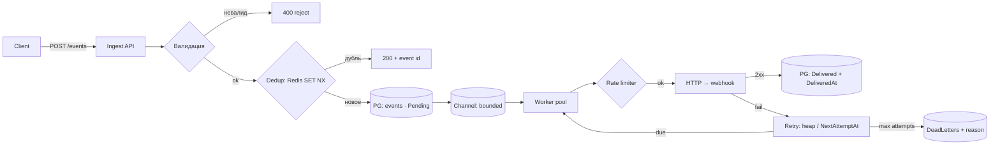

# PLAN — data flow и журнал решений

> Заполняется вручную перед каждой стадией (см. AGENTS.md).

## Data flow события

Ключевой принцип: событие становится **непотеряемым** в момент записи
в Postgres (стадия `DB`). До этого оно либо отвергнуто клиенту (400),
либо ещё не принято (нет 202 — клиент ретраит). После записи — наша
ответственность до `Delivered` или `DeadLettered`.

## Карта «дубль / потеря» по стадиям

| Стадия | Дубль возможен? | Потеря возможна? | Почему |
| --- | --- | --- | --- |
| HTTP приём → валидация | повторный POST клиента | нет — без 202 событие «не принято», клиент ретраит | потеря считается только после принятия |
| Dedup (Redis SET NX) | да — после истечения TTL-окна или при другом ключе | при Redis-down: зависит от политики fail-open/fail-closed (открытый вопрос) | Redis — быстрый фильтр, не истина |
| Запись в PG | нет — unique-индекс на IdempotencyKey | край: SET NX успел, insert нет → повтор клиента отсекается как дубль, а записи не было (открытый вопрос) | индекс — жёсткая граница |
| Channel (in-memory) | нет | да — но событие уже в PG, восстановление по Status=Pending | очередь — транспорт, не хранилище |
| Worker → отправка | да — endpoint получил, воркер умер до записи ack → ретрай | нет — фейл уходит на ретрай | допустимый дубль at-least-once |
| Retry heap | нет | при рестарте, если heap только в памяти (открытый вопрос) | нужна стратегия восстановления |
| DLQ | replay может дать дубль (допустимо) | нет — терминально, но читаемо и replayable | карантин, не мусорка |

## Метрики (черновик TASK-009 — на ревью юзера)

| Метрика | Какой сбой/деградацию видно |
| --- | --- |
| `dedup.hit_ratio` (dup/accepted) | всплеск повторной посылки клиентов; падение → кеш сдулся/Redis лёг |
| `queue.depth` (Pending+InFlight+RetryScheduled) | рост → доставка не успевает за приёмом; 503 при потолке |
| `delivery.duration_ms` (p50/p95) | endpoint получателя деградирует раньше, чем начнутся 5xx |
| `delivery.retry_rate` | доля событий на ретраях — упавший endpoint или наш баг |
| `dlq.size` (live) | молчаливая смерть событий; растёт → причина в reason |
| `sweeper.stale_reclaims` | воркеры умирают/зависают — lease срабатывает слишком часто |
| `latency.to_ack` (CreatedAt→DeliveredAt) | сквозная задержка системы, SLO-метрика |

## Журнал решений

| Дата | Решение | Контекст / почему |
| --- | --- | --- |
| 2026-10-16 | Порядок приёма: валидация → dedup → PG → очередь → 202 | v1 (очередь → dedup → валидация → БД) отклонён: событие в памяти до записи = окно потери; дубли жрут ёмкость канала; unique-индекс и так ловит повторные записи |
| 2026-10-16 | Ответ клиенту: `202 Accepted` + event id, только после записи в PG | 202 = «приняли, доставим»; id нужен клиенту для статуса в кабинете |
| 2026-10-16 | Невалидное на входе → 400, не в DLQ | DLQ — для принятых, но недоставленных; мусор чинит клиент |
| 2026-10-16 | Ack = `Status=Delivered` + `DeliveredAt` после 2xx | до ack событие обязано быть где-то в системе |
| 2026-10-16 | При 500/timeout от endpoint'а — авто-ретрай (не только лог) | логи для людей, ретрай — поведение системы; см. TASK-005 |
| 2026-10-16 | Ключ дедупа = SHA256(webhookId + payload) | без webhookId одинаковый payload для разных webhook'ов слился бы в один ключ — решение юзера |
| 2026-10-16 | Ответ на дубль: `200` + исходный event id + флаг duplicate | клиент получает idempotent-ответ и может спросить статус события — решение юзера |
| 2026-10-16 | Redis-down при dedup: fail-open (пропускаем дальше) | unique-индекс PG всё равно ловит дубль при insert — Redis лишь быстрый фильтр; fail-closed резал бы доступность без выигрыша в корректности |
| 2026-10-16 | Dedup-порядок: insert в PG → затем SET NX в Redis | insert сам отсекает дубли индексом; закрывает край «SET успел, умер до insert» |
| 2026-10-16 | TTL окна дедупа: 24ч (конфигурируемо) | ориентир — Stripe: их idempotency-ключи живут 24ч; окно = горизонт поздних ретраев клиента, не сетевая задержка |
| 2026-10-17 | Insert-first подтверждён юзером | PG-индекс = источник истины, Redis = fast-path кеш |
| 2026-10-17 | Redis-down → fail-open, подтверждено | PG-индекс ловит дубли независимо; цена — лишние insert-попытки при лёжке Redis |
| 2026-10-17 | Sweeper обязателен | скан `Pending`, добирает «в PG есть, в канал не попало» (рестарт, переполнение); бережный — батчи + интервал |
| 2026-10-17 | Переполнение: вариант D с потолком | всегда insert в PG + 202; reject 503 только когда `Pending` > порога (конфиг). PG = настоящая очередь, канал = fast-path. Потолок защищает таблицу от раздувания |
| 2026-10-17 | Capacity канала ~10k | буфер на разрыв producer/consumer; ~10сек всплеска при стопе доставки |
| 2026-10-17 | Rate-limit delay и retry — ОДИН механизм отложенной отправки | спящий воркер блокирует чужие события (head-of-line); задержка — это scheduled, не sleep |
| 2026-10-17 | Backoff: max 5 попыток; base 1с, ×2, cap 5мин — подтверждено | юзер подтвердил дефолты |
| 2026-10-18 | Checkpoint TASK-002/003 — частично (делегировано) | юзер верно нашёл fail-open, lease по UpdatedAt, retryable-коды; гонку разруливает PG-индекс (не Redis) — отвечено Devin; сценарий «умер до SaveChanges» → дубль получателю, потери нет |
| 2026-10-17 | TASK-004/005 — режим «руками»: Devin не пишет, только менторит | учебные тикеты, чистые алгоритмы |
| 2026-10-19 | Checkpoint В1 — верно; В2 (почему depth считает все статусы) — не закрыт, отложен | ответы юзера по-честному |
| 2026-10-19 | TASK-006 эндпоинты делегированы Devin; DLQ-семантика — на ревью юзера | усталость, явное «делай сам» |
| 2026-10-19 | P-05 SignalR фид: воркер паблишит статус после SaveChanges; ошибки фида глушим — наблюдаемость не блокирует доставку | платформа, делегировано |
| 2026-10-19 | D15 архитектурный стиль: модульный монолит, Core/Infrastructure/Api; не микросервисы и не многослойка — обоснование в architecture.md | запрос юзера «зафиксировать почему» |
| 2026-10-19 | P-06 дашборд + `GET /stats`; vite-прокси → :5269, CORS не используем; npm-скрипты через `node ...` из-за пробела в пути | платформа, делегировано |
| 2026-10-20 | P-07 LoadGen (rps/burst/dup); dashboard в compose через nginx-прокси; P-02 закрыт без IRepository по D15 | платформа, делегировано; Docker не проверен |
| 2026-10-21 | D16 bucket capacity = RateLimitPerSecond (секунда всплеска); jitter = equal (`delay/2 + rand(delay/2)`) | юзер выбрал; equal стабильнее — есть гарантированный половинный пол |
| 2026-10-21 | Checkpoint: В3/В6/T1 разобраны голосом, частично — пояснения записаны (atomic claim; dedup TTL vs PG-вечность; дубль приёма vs отправки) | юзер отвечал в 2 ночи, фиксирую честно |
| 2026-10-24 | TASK-004 написан юзером — логика верная; исправлено: дубликаты stub-методов, epsilon на границе токена; тесты делегированы Devin (6 зелёных) | hands-on выполнен; чекпоинт-объяснение ждёт |
| 2026-10-24 | Гонка enqueue (В3) починена атомарным claim'ом `Pending→InFlight` в ingest и sweeper; откат при полном канале | край из guide.md |
| 2026-10-24 | Лимитер врезан: `TokenBucketRateLimiter` (ConcurrentDictionary, D6/L1) + воркер откладывает по wait через RetryScheduled (D7); сигнатура `AcquireDelayAsync(+permitsPerSecond)` — на ревью | делегировано |
| 2026-10-24 | TASK-008 `ConsistentHashRing` реализован (делегировано), в систему не врезан — ждёт мульти-инстанс | review |
| 2026-10-24 | `/metrics`: EngineMetrics-счётчики + DB-derived (depth, dlq_live, ratios); `/health` → readiness PG+Redis; таблица метрик — черновик | TASK-009 частично |
| 2026-10-24 | D14 реализована: HMAC-SHA256 подпись тела (`X-Webhook-Signature`); воркер шлёт `webhook.Secret`; `MockReceiver` в compose + лог подписи; параллелизм воркеров `Delivery:WorkerParallelism` | платформа |
| 2026-10-25 | Redis fail-open закрыт на DI-границе: `abortConnect=false` — мёртвый Redis больше не роняет ingest резолвом | гарантия |
| 2026-10-25 | TASK-005 (делегировано): `BackoffPolicy` exp·2^a + equal jitter + cap 5мин + max 5; `HeapRetryScheduler` — версионный lazy deletion; воркер: max-attempts → DLQ, schedule после SaveChanges; sweeper: heap fast-path + PG-скан (истина) | review — ждёт защиты юзером |
| 2026-10-25 | Модель разработки зафиксирована: Kanban + XP соло (AGENTS) | процесс |
| 2026-10-25 | `GET /webhooks`, `GET /events`, `GET /events/{id}` (+attempts), `DELETE /received` у MockReceiver — read-side дозакрыт | платформа |
| 2026-10-17 | Неретраябельное: 4xx (кроме 429), кривой payload, неактивный webhook | правило: «изменится ли ответ от повтора?» нет → не ретрай |
| 2026-10-17 | DLQ-условия: исчерпаны ретраи / неретраябельная ошибка / невалидный payload post-accept / webhook деактивирован | невалидное на входе — всё ещё 400, не DLQ |
| 2026-10-17 | Replay идёт в обход dedup (тот же ключ съест фильтр) | status→Pending, история attempts — аудит, не трём |
| 2026-10-17 | MVP без клиентского Idempotency-Key (content-hash); header — эволюция | юзер спросил «кому нужно» — клиентам со своими event id; отложено |
| 2026-10-25 | TASK-010 EXPLAIN на 4806 строках: due-scan и stale-scan оба едут по `IX_Events_Status_NextAttemptAt` (0.07мс/0.02мс); **L4 решён — держим полный индекс**: partial на (0,2) сломал бы stale-scan в seq scan, а выигрыш 80кБ→~2кБ ничтожен; второй partial = write amplification без причины | делегировано Devin, на ревью |
| 2026-10-25 | depth `COUNT(Status IN 0,1,2)` — Index Only Scan только по живым поддеревьям (delivered лежат в другой ветке ключа) → стоимость ограничена размером работы, не таблицы; прежняя тревога «горячий COUNT» снята данными | делегировано |
| 2026-10-25 | `NextAttemptAt = CreatedAt` вместо NULL — отложено: OR+Filter в due-scan и так едет по индексу за 0.07мс; трюк дал бы чистый range, но цена — семантика «null = сейчас» и так работает | делегировано, low value |
| 2026-10-25 | `/stats` = Seq Scan + HashAggregate (0.7мс на 5к; ~300мс на 1M строк каждые 2с — реальная точка роста). Не индексируется осмысленно; лечится кэшем из EngineMetrics-итогов при шкале — в scale-волну `next.md` | делегировано |

## Карта границ: где дубль, где потеря (доказано живьём)

Финальный критерий проекта — каждая строка подтверждена прогоном
(доказательства: done-log таблица 9 сбоев, LoadGen 6000 событий).

| Стадия | Дубль возможен? | Потеря возможна? | Механизм / страж | Доказательство |
| --- | --- | --- | --- | --- |
| POST /events, PG упал | нет | **нет** — клиент получает 5xx, не 202 | честный отказ до accept | хаос #1: HTTP 500 |
| POST /events, Redis упал | нет | нет | fail-open → PG unique `IdempotencyKey` ловит дубль | хаос #2: 2-й POST = duplicate без Redis |
| Ack после commit, клиент не услышал ответ | **да** — клиент ретраит → наш дубль на входе | нет | клиент видит timeout, но событие в PG; ретрай клиента → `duplicate` ответ, не второе событие | T5 разобран |
| Redis TTL истёк, тот же ключ | нет | нет | PG unique бессрочен (В8 — принято) | хаос #9: TTL=0 → всё равно duplicate |
| Claim → канал (канал полон) | нет | нет | `Pending` остаётся в PG, sweeper добирает тиком | хаос #4: cap=1, 3/3 доставлены |
| Воркер умер после claim, до send | нет | нет | lease `InFlightTimeout` → sweeper реклеймит → повторный enqueue | хаос #7 стадия reclaim |
| Send успешен, ACK/статус не записан (крах) | **да** — reclaim → повторная отправка | нет | at-least-once: дубль легален, потеря — нет | В7: две строки attempt#1 живьём |
| Медленный канал > lease (В7) | **да** — второй воркер отправляет параллельно | нет | принято как граница; починка — lease-version в scale-волне | хаос #7: attemptCount=2 на 3 send'а |
| Ретрай в куче, процесс убит | нет | нет | `NextAttemptAt` в PG — истина; куча — ускоритель, ребилдится сканом | хаос #3: ретраи продолжились после kill |
| Endpoint 500 всегда | нет | **нет — карантин, не потеря** | MaxAttempts → DLQ + `DeadLetterItem.Reason` | хаос #5: 5 попыток → DLQ |
| Endpoint flap 500↔200 | да (ретрай = повторная отправка by design) | нет | equal-jitter backoff: шанс на 200 за 5 попыток | хаос #6: [500,200] → Delivered |
| Replay из DLQ | по воле оператора (не авария) | нет | обход dedup, AttemptCount→0, история — аудит | хаос #8: повторный цикл доставки |
| Клиентская повторная отправка с новым телом | нет | нет | другой content-hash = другой ключ = новое событие (корректно) | по построению |

**Итог:** потери нет ни на одной стадии после accept (202) —
единственный «отказ» до accept честно возвращает 5xx. Дубли —
только на трёх названных границах и все они легальны по
at-least-once. Единственный «грязный» дубль — В7 (задокументирован).

## Открытые вопросы

- С content-hash ключом «то же событие через 25ч» всё ещё ловится
  PG-индексом. Хотим ли различать «повтор той же отправки» vs «новое
  событие с тем же телом»? Нужен клиентский Idempotency-Key header —
  эволюция, не MVP
- ~~Отложенные ретраи: heap при рестарте~~ ✓ решено: PG-скан — истина,
  heap — ускоритель (TASK-005)
- ~~Подпись webhook'ов~~ ✓ сделано: `X-Webhook-Signature` (D14)
- ~~**L4**~~ ✓ решено данными (2026-10-25): полный индекс держим —
  оба горячих скана по нему едут; partial ломал бы stale-scan.
  См. журнал выше
