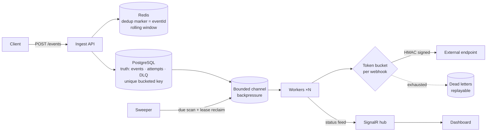

# webhook-engine

A real-time notification & webhook delivery engine built around one idea:
**at-least-once delivery is a system property, not a feature**.

It accepts events over HTTP and delivers them to subscribed webhook
endpoints — reliably, under load, and honestly about failure.

> **What this is:** a learning-driven build that grew into a working
> system. Every guarantee boundary was designed, implemented, then
> attacked with chaos failures until it held — and every decision,
> bug and trade-off is written down in `docs/`. It's for
> anyone who wants to see dedup, backpressure, retries and DLQ
> actually work, not just read the theory. **~140 files, ~9.9k lines
> of source + docs.** Contributing: [CONTRIBUTING.md](CONTRIBUTING.md).

## What it guarantees

- **At-least-once delivery** — an accepted event is persisted before it's
  acknowledged. Duplicates are acceptable by design; loss is not.
- **Idempotent ingest, honest window** — rolling dedup: a Redis
  `SET NX` content marker stores the original `eventId` (TTL from
  first sight → duplicate answers cost zero PG reads), while a
  Postgres unique constraint on a *time-bucketed* key holds the hard
  boundary. Same content in the next window = a new event — the way
  Stripe-style idempotency actually works.
- **Backpressure** — bounded channels with an explicit overflow policy
  instead of silent OOM.
- **Per-webhook rate limiting** — token bucket per endpoint, so receivers
  don't ban us.
- **Retries** — in-memory min-heap with versioned lazy deletion over
  a durable Postgres schedule; exponential backoff + equal jitter;
  exhausted events land in a queryable DLQ, replayable after fixes.
- **Signed webhooks** — `X-Webhook-Signature: sha256=<hex>` HMAC over
  the payload per endpoint secret.
- **Observability** — `/metrics` counters + ratios, PG/Redis readiness
  probe, SignalR status feed and a React dashboard (status cards,
  metrics strip, event list with attempt history, DLQ replay).

## Stack

.NET (C#) · PostgreSQL + EF Core · Redis · SignalR · React + TypeScript ·
docker-compose

### Stack — every choice justified

| Choice | Why it's here | Rejected |
| --- | --- | --- |
| **PostgreSQL** | The durability boundary — a row exists before 202 is sent; `IdempotencyKey` UNIQUE is the hard dedup edge; `NextAttemptAt` is the durable schedule | Redis-as-truth (restart = loss), a broker pretending to be a database |
| **Redis** | Dedup fast path — a hit answers a duplicate with zero PG reads; future rate-limit state | Making Redis the boundary (its fail-open would then mean loss, not just slowdown) |
| **Bounded `Channel`** | Backpressure is a policy, not a bigger buffer: full channel → honest 503, PG `Pending` + sweeper covers the gap | RabbitMQ/Kafka — a broker to operate for a lesson that's about queues, not brokers |
| **EF Core, no `IRepository`** | Migrations are the schema truth; `DbContext` is used directly where hot paths need it | A repository wrapper that hides exactly the failure modes this project studies |
| **SignalR + React dashboard** | Guarantees are verified by watching them — attempts, retries and DLQ visible live, chaos modes one click away | Polling REST; "read the logs" observability |
| **MockReceiver + LoadGen** | Proof is a run, not a paragraph — chaos endpoints (`500/429/slow/flap/drop`) + real rps with mixed duplicates | "The unit tests pass" |
| **docker-compose** | Postgres+Redis+API+dashboard+receiver in one command | k8s — orchestration theatre for a single host |

Deliberately **not** in the stack: a message broker, a DTO/mapper
layer, distributed-tracing infrastructure. Each would add a moving
part without teaching anything about delivery guarantees.

## Architecture



Full diagram set (dedup flow, request sequence, status state
machine, ER schema): [docs/diagrams/system.md](docs/diagrams/system.md).
The DB model explained — per-table/index rationale and measured
load behavior: [docs/database.md](docs/database.md).
Reasoning behind every ordering choice and the evidence-backed
boundary table: [docs/failure-map.md](docs/failure-map.md).

## Dashboard

Live ops panel — status cards, engine metrics, event/attempt
drill-down, DLQ with one-click replay, SignalR live feed — plus a
**Playground**: register the six MockReceiver chaos endpoints and
fire real events by clicking `send 1`/`send 10`. Retries, dead
letters and replay show up on screen within seconds — the fastest
way to feel what the engine does:


Details: [dashboard/README.md](dashboard/README.md).

## Repository layout

```
src/
  WebhookEngine.Api            HTTP ingest, SignalR, DI wiring, workers
  WebhookEngine.Core           domain models + delivery-guarantee contracts
  WebhookEngine.Infrastructure Postgres (EF Core), Redis, external plumbing
dashboard/                     React + TS ops dashboard (stats, metrics, events, DLQ, live feed)
tools/LoadGen/                 load generator (rps, burst, duplicate rate)
tools/MockReceiver/            test webhook receiver with chaos modes (500/429/slow/flap/drop)
tests/
  WebhookEngine.Tests          unit + chaos tests
docs/                          architecture spec, database rationale,
                               failure-map (evidence table), diagrams
```

## Getting started

```bash
# Full stack — one command, no manual steps (EF migrations run at startup):
docker compose -p webhook-engine up --build
#   api :8080 · dashboard :3000 · mockreceiver :5005 · postgres :5433 · redis :6379

# or run deps only and the API + dashboard locally:
docker compose -p webhook-engine up -d postgres redis
dotnet run --project src/WebhookEngine.Api # http://localhost:5269
cd dashboard && npm install && npm run dev # http://localhost:5173
```

Sanity check: `curl localhost:8080/health` → `{"status":"ok",...}`.

**Verify everything in one command** — the live smoke test walks
the whole API surface (20 checks: validation, dedup same-id,
chronological attempts, DLQ, replay, SignalR negotiate):

```bash
node tests/smoke.mjs                    # API on :5269
API=http://localhost:8080 DASH=http://localhost:3000 node tests/smoke.mjs
# full compose: the API container reaches the receiver by service name
API=http://localhost:8080 DASH=http://localhost:3000 \
RECEIVER=http://mockreceiver:5005 node tests/smoke.mjs
```

To see the failure paths live, point a webhook at
`http://localhost:5005/hook?mode=<one-of: 500, 429, slow, flap, drop>`
(e.g. `?mode=500`) — or just use the dashboard Playground and watch.

## API surface

```
POST /webhooks                    register endpoint (url, secret, rate limit)
GET  /webhooks                    list endpoints
POST /events                      ingest (idempotent; 202 accepted / duplicate)
GET  /events?take=&status=        recent events
GET  /events/{id}                 event detail + attempt history
GET  /deadletters                 DLQ (latest 200, live entries)
POST /deadletters/{id}/replay     replay a dead-lettered event (bypasses dedup)
GET  /stats                       status counts + live DLQ count
GET  /metrics                     counters, dedup/retry ratios, queue depth
GET  /health                      readiness: Postgres + Redis ping (503 on degrade)
GET  /hubs/status                 SignalR status feed
```

## Status

Full delivery loop verified end-to-end on the containerized stack:
ingest with dedup → atomic claim → bounded queue → parallel workers →
token bucket → signed send → backoff/jitter retries → DLQ + replay.

**Proven live:** 9 chaos failures reproduced on the running system
(PG/Redis down, restart mid-retry, full channel, flapping endpoint,
lease expiry mid-send) — every guarantee held. Three LoadGen runs
(2,055 / ~4,800 / 803 accepted events, duplicates mixed in) — zero
loss after accept. The evidence-backed duplicate/loss map lives
in [docs/failure-map.md](docs/failure-map.md).

Shipped and verified live: H-1 (honest dedup window), H-2 (client
`Idempotency-Key` header), H-3 (lease-versioned claims). Remaining:
the scale wave — Redis-backed limiter, leader election,
multi-instance.

## Who built what

The delivery-guarantee core — dedup keying and window, retry
scheduler, token bucket, backpressure policy, DLQ semantics — was
designed and written **by hand**, because that's where "at least
once" is won or lost. The platform plumbing around it (ASP.NET
skeleton, SignalR wiring, EF schema, dashboard, compose) was built
with an AI pair under explicit, written-down rules; chaos scenarios
were co-designed and every finding routed back into code or docs.

## What building this actually trained

- **Idempotency design** — key composition (`webhook:payload:bucket`),
  window vs forever, why the stored value should be the original
  event id, and how Redis-hit and PG-23505 duplicates differ.
- **Durable-first ordering** — accept only after the row exists;
  enqueue is an accelerator, never the source of truth.
- **At-least-once acceptance** — a duplicate send is recoverable;
  a lost event is not. Every "optimize" that risks loss is a bug.
- **Retry scheduling** — capped exponential backoff + equal jitter,
  versioned lazy deletion in a heap, PG `NextAttemptAt` as truth.
- **Lease semantics** — InFlight timeout, stale reclaim, and the
  parallel-dup edge that motivated `ClaimVersion` (H-3).
- **Backpressure** — a full channel is a signal, not a queue;
  honest 503 beats silent OOM.
- **Boundary observability** — counters exactly where guarantees
  live (`dedupHits`, `staleReclaims`, `sendsRetryable`), a SignalR
  feed, and a dashboard strict enough to debug by screenshot.
- **Honest engineering** — chaos-proven claims only; every failure
  mode either got fixed or got documented in `docs/guide.md`.

## License

MIT
