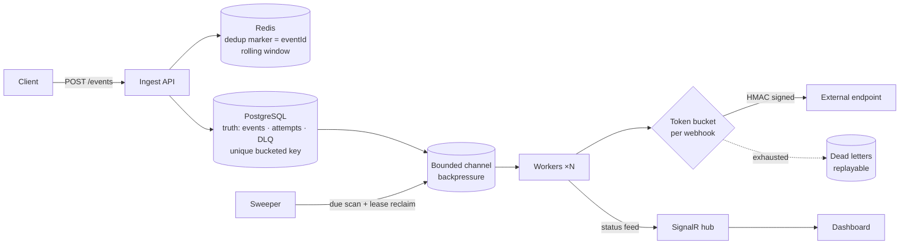
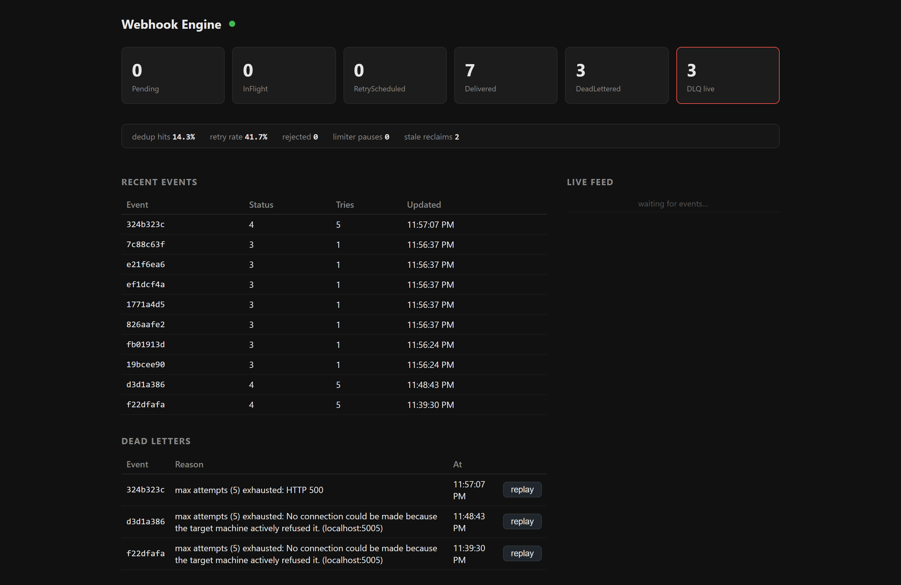

# webhook-engine

A real-time notification & webhook delivery engine built around one idea:
**at-least-once delivery is a system property, not a feature**.

It accepts events over HTTP and delivers them to subscribed webhook
endpoints — reliably, under load, and honestly about failure.

## What it guarantees

- **At-least-once delivery** — an accepted event is persisted before it's
  acknowledged. Duplicates are acceptable by design; loss is not.
- **Idempotent ingest, honest window** — rolling dedup: a Redis
  `SET NX` content marker stores the original `eventId` (TTL from
  first sight → duplicate answers cost zero PG reads), while a
  Postgres unique constraint on a *time-bucketed* key holds the hard
  boundary. Same content in the next window = a new event — the way
  Stripe-style idempotency actually works.
- **Backpressure** — bounded channels with an explicit overflow policy
  instead of silent OOM.
- **Per-webhook rate limiting** — token bucket per endpoint, so receivers
  don't ban us.
- **Retries** — in-memory min-heap with versioned lazy deletion over
  a durable Postgres schedule; exponential backoff + equal jitter;
  exhausted events land in a queryable DLQ, replayable after fixes.
- **Signed webhooks** — `X-Webhook-Signature: sha256=<hex>` HMAC over
  the payload per endpoint secret.
- **Observability** — `/metrics` counters + ratios, PG/Redis readiness
  probe, SignalR status feed and a React dashboard (status cards,
  metrics strip, event list with attempt history, DLQ replay).

## Stack

.NET (C#) · PostgreSQL + EF Core · Redis · SignalR · React + TypeScript ·
docker-compose

## Architecture



Full diagram set (dedup flow, request sequence, status state
machine, ER schema): [docs/diagrams/system.md](docs/diagrams/system.md).
Reasoning behind every ordering choice: [PLAN.md](PLAN.md).

## Dashboard

Live ops panel — status cards, engine metrics, event/attempt
drill-down, DLQ with one-click replay, SignalR live feed:



Details: [dashboard/README.md](dashboard/README.md).

## Repository layout

```
src/
  WebhookEngine.Api            HTTP ingest, SignalR, DI wiring, workers
  WebhookEngine.Core           domain models + delivery-guarantee contracts
  WebhookEngine.Infrastructure Postgres (EF Core), Redis, external plumbing
dashboard/                     React + TS ops dashboard (stats, metrics, events, DLQ, live feed)
tools/LoadGen/                 load generator (rps, burst, duplicate rate)
tools/MockReceiver/            test webhook receiver with chaos modes (500/429/slow/flap/drop)
tests/
  WebhookEngine.Tests          unit + chaos tests
docs/                          architecture spec, task backlog, diagrams
  guides/                      concept guides (EN): hands-on tasks, stack Q&A
  ru/, guides/ru/              Russian originals of the translated docs
PLAN.md                        data flow map + decision journal (ADR-style)
```

## Getting started

```bash
# Full stack — one command, no manual steps (EF migrations run at startup):
docker compose -p webhook-engine up --build
#   api :8080 · dashboard :3000 · mockreceiver :5005 · postgres :5433 · redis :6379

# or run deps only and the API + dashboard locally:
docker compose -p webhook-engine up -d postgres redis
dotnet run --project src/WebhookEngine.Api # http://localhost:5269
cd dashboard && npm install && npm run dev # http://localhost:5173
```

Sanity check: `curl localhost:8080/health` → `{"status":"ok",...}`.
To see the failure paths live, point a webhook at
`http://localhost:5005/hook?mode=<one-of: 500, 429, slow, flap, drop>`
(e.g. `?mode=500`) and watch the dashboard.

## API surface

```
POST /webhooks                    register endpoint (url, secret, rate limit)
GET  /webhooks                    list endpoints
POST /events                      ingest (idempotent; 202 accepted / duplicate)
GET  /events?take=&status=        recent events
GET  /events/{id}                 event detail + attempt history
GET  /deadletters                 DLQ (latest 200, live entries)
POST /deadletters/{id}/replay     replay a dead-lettered event (bypasses dedup)
GET  /stats                       status counts + live DLQ count
GET  /metrics                     counters, dedup/retry ratios, queue depth
GET  /health                      readiness: Postgres + Redis ping (503 on degrade)
GET  /hubs/status                 SignalR status feed
```

## Status

Full delivery loop verified end-to-end on the containerized stack:
ingest with dedup → atomic claim → bounded queue → parallel workers →
token bucket → signed send → backoff/jitter retries → DLQ + replay.

**Proven live:** 9 chaos failures reproduced on the running system
(PG/Redis down, restart mid-retry, full channel, flapping endpoint,
lease expiry mid-send) — every guarantee held. Three LoadGen runs
(2,055 / ~4,800 / 803 accepted events, duplicates mixed in) — zero
loss after accept. The evidence-backed duplicate/loss map lives
in [PLAN.md](PLAN.md#failure-boundary-map-where-duplicates-where-loss-proven-live).

Remaining: hands-on tasks H-2 (client `Idempotency-Key` header) and
H-3 (lease-versioned claims) — H-1 (honest dedup window) shipped and
verified live — plus the scale wave (Redis-backed limiter, leader
election, multi-instance). See [docs/tasks.md](docs/tasks.md) for the
backlog and [docs/next.md](docs/next.md) for the construction queue.

## License

MIT
