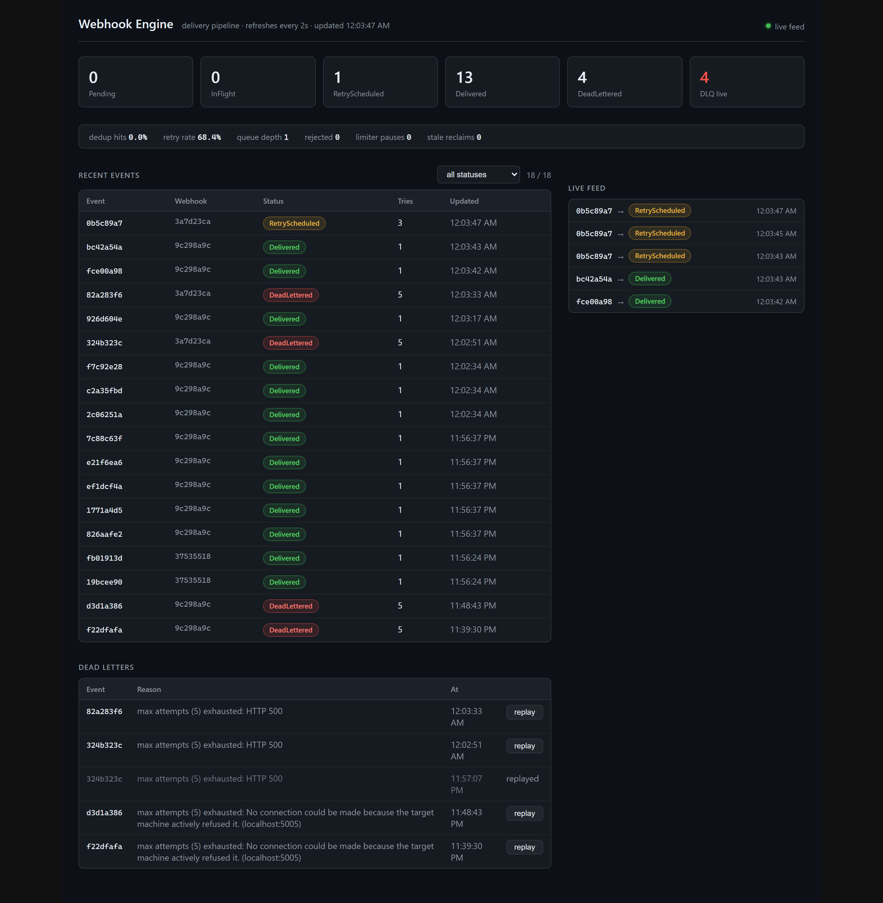

# Webhook Engine — dashboard

Live operations panel for the engine. React + TypeScript + Vite,
SignalR for the real-time feed. Everything on screen maps to an API
endpoint — the dashboard is a read/monitor surface, the only action
it performs is DLQ replay.



## What you see

| Panel | Source | What it tells you |
| --- | --- | --- |
| Status cards (Pending / InFlight / RetryScheduled / Delivered / DeadLettered + `DLQ live`) | `GET /stats` (3s `StatsCache` snapshot) | queue shape; `DLQ live` is the accumulating quarantine |
| Metrics strip | `GET /metrics` | `dedup_hit_ratio`, `delivery_retry_rate`, queue depth, rejected events, limiter pauses, `StaleReclaims` (the "silent worker death" detector) |
| Recent events (30) | `GET /events?take=30` | newest events — status **badges**, webhook id, attempt count; status filter dropdown |
| Attempts detail | `GET /events/{id}` | click a row → every send: HTTP code (colored), ms, error |
| Dead letters | `GET /deadletters` | quarantined events + reason; **replay** button → `POST /deadletters/{id}/replay` (bypasses dedup, resets attempt budget); replayed rows stay visible as audit |
| Live feed (50) | SignalR `/hubs/status`, message `"status"` | status transitions as the worker writes them, badge-colored |
| Header | — | refresh timestamp + SignalR connection indicator |

Usability details: statuses are semantic badges (amber = retrying,
red = dead-lettered, etc.); event ids are **click-to-copy**; event
rows are clickable for attempt history; HTTP codes in attempts are
colored by outcome.

Polling: `refresh()` every 2s (stats/metrics/events/dlq). The live
feed is push — no polling. All counters are `EngineMetrics`
singletons published at the same boundaries they measure.

## Run

```bash
# standalone (API on :5269, vite proxies /stats /events /hubs → api)
cd dashboard
npm install
npm run dev          # http://localhost:5173

# or the full compose stack — nginx serves the built bundle
docker compose -p webhook-engine up   # http://localhost:3000
```

`vite.config.ts` proxies API routes and the SignalR upgrade to the
local API; `nginx.conf` does the same inside compose. Change the API
address there, not in `api.ts` — every call is a relative URL.

## Files

- `src/App.tsx` — the whole UI: polling loop, SignalR subscription, panels
- `src/api.ts` — typed API surface (`Stats`, `Metrics`, `EngineEvent`, `EventDetail`, `DeadLetter`)
- `nginx.conf` — production proxy for the compose deployment
- `vite.config.ts` — dev proxy
