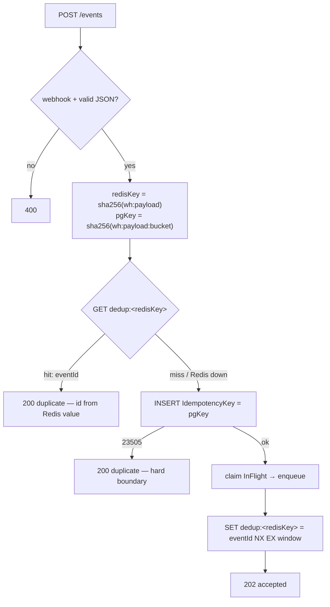

# Notification & Webhook Engine — architecture & spec

A real-time notification delivery service (Webhooks, Push/Email in
perspective) with **at-least-once delivery**, exponential retries
and rate limiting for third-party APIs.

Load target: millions of events, ~1M events/sec peaks without falling
(the emphasis is on backpressure, not on real iron capacity).

## Stack

| Layer | Technology |
| --- | --- |
| Backend | .NET (C#), ASP.NET, `System.Threading.Channels`, `IAsyncEnumerable` |
| Deduplication / rate limit | Redis |
| Persistence | PostgreSQL (EF Core migrations) |
| Real-time status | SignalR |
| Dashboard | React + TypeScript |
| Infra | docker-compose (app + redis + postgres) |

Mermaid versions of the diagrams: [diagrams/system.md](diagrams/system.md)

## Architectural style (fixed, D15)

**Modular monolith.** Three projects — split by responsibility, not by
layers for layers' sake:

| Project | What lives there | Depends on |
| --- | --- | --- |
| `Core` | models, abstractions (interfaces), pure algorithms | nothing |
| `Infrastructure` | adapters: EF/Postgres, Redis, HttpClient | Core |
| `Api` | composition root: DI, endpoints, workers, hubs | both |

**Why this and not otherwise:**

- **Not microservices.** The at-least-once guarantee holds on the
  boundaries "accepted → persisted → sent → acked". Spreading them
  across the network multiplies failure modes for no reason: no part
  of the system needs independent deployment or scaling right now.
  The bottleneck is outbound HTTP and Postgres, not process
  modularity.
- **Not three-tier / not six-project Clean.** Core is the only "pure"
  zone, and its purity is not decorative: the algorithms (bucket,
  heap) are testable with zero infrastructure. An interface exists
  only where a real replaceable boundary exists: dedup (Redis↔another
  cache), queue, scheduler, limiter, feed. No `IRepository` over EF
  "because you're supposed to".
- **Dependencies point inward.** Infrastructure/Api know Core; Core
  doesn't know them. Verified by Core building with no infra NuGets.

**Where it can evolve** (only when the need appears): multiple Api
instances → Redis-backed rate limiter, sweeper leader election,
consistent hashing (TASK-008). Each step is its own justified
decision, not "built for growth".

## Components

```
            ┌──────────┐   ┌────────────┐   ┌──────────────┐
events ───> │ Ingest   │─> │ Dedup      │─> │ Queue        │
  HTTP      │ API      │   │ (Redis)    │   │ (Channels)   │
            └──────────┘   └────────────┘   └──────┬───────┘
                                                   │
            ┌──────────┐   ┌────────────┐   ┌──────▼───────┐
  SignalR   │ Status   │<──│ Dispatcher │<──│ Rate limiter │
  updates   │ feed     │   │ / workers  │   │ (per-hook)   │
            └──────────┘   └──────┬─────┘   └──────────────┘
                                  │ send
                            ┌─────▼──────┐   ┌──────────────┐
                            │ Webhook    │──>│ Retry        │
                            │ endpoints  │   │ scheduler    │
                            └────────────┘   │ (min-heap)   │
                                  │          └──────┬───────┘
                                  │ exhausted       │ due
                            ┌─────▼──────┐          │
                            │ DLQ        │<─────────┘
                            │ (Postgres) │
                            └────────────┘
```

- **Ingest API** — event intake, validation, event id issuance.
- **Dedup** — rolling window: Redis `SET NX EX` content marker (eventId
  as the value) + a bucketed SHA256 key under the PG unique index.
- **Queue** — bounded `Channel`, backpressure policy on overflow.
- **Dispatcher/workers** — worker pool; consistent-hash webhook
  distribution across nodes at horizontal scale.
- **Rate limiter** — token bucket per webhook endpoint.
- **Retry scheduler** — min-heap of deferred sends, backoff + jitter.
- **DLQ** — events that exhausted retries; view + replay via dashboard.

## Algorithms & structures

- **Token bucket** — RPS control per external webhook.
- **Priority queue (min-heap)** — deferred retries by `nextAttemptAt`.
- **Consistent hashing** — webhook-worker distribution across nodes.
- **SHA256 + Redis SET NX** — idempotency at ingest.

## Delivery guarantees

- **At-least-once**: duplicates are possible — dedup at ingest +
  idempotency keys in the payload; the receiver must tolerate a repeat.
- **Loss is not allowed**: an event counts as delivered only after
  ack; before ack it lives in the queue / retry / DLQ.
- Open boundary questions (where exactly a dup/loss can occur) —
  see `PLAN.md` (the proven boundary map lives there).

## DB schema (stage 1, implemented)

- `webhook_endpoints` — Url, Secret, RateLimitPerSecond, IsActive
- `notification_events` — IdempotencyKey (unique), Payload (jsonb),
  Status, AttemptCount, NextAttemptAt, DeliveredAt;
  index `(Status, NextAttemptAt)` — due-retry scan
- `delivery_attempts` — attempt history: response code, error, duration
- `dead_letter_items` — Reason, DeadLetteredAt, ReplayedAt

**Double dup protection (H-1, rolling window):** the Redis marker
`dedup:sha256(webhookId:payload)` → `eventId` is the fast filter —
a duplicate answer costs zero PG reads; `SET NX EX` anchors the TTL
at first sight. The PG unique index holds the hard boundary on a
**bucketed** key `sha256(webhookId:payload:bucket)` —
`bucket = unixTimeSeconds / windowSeconds`. An index can't be
time-relative, so time rides inside the key: identical content in the
next window is a *new* event, not a permanent dedup. Redis down =
fail-open; the only residual dup needs Redis down *and* two POSTs
straddling a bucket boundary — bounded and documented.



**Open schema questions** (resolved in tickets):
- ~~Lease/ownership~~ — implemented: `InFlight` + `UpdatedAt`, expiry
  via sweeper (`InFlightTimeoutMinutes`). Edges: enqueue race —
  see guide.md "Known edges"
- Deferred-retry storage: currently `NextAttemptAt` swept by the
  sweeper; in-memory heap came with TASK-005 (acceleration, PG stays truth)
- ~~What goes into `IdempotencyKey`~~ — resolved (H-1): PG key =
  `sha256(wh:payload:bucket)` inside the window; Redis keeps the
  stable content key with rolling TTL. Client `Idempotency-Key`
  header is the next evolution (H-2)

## Roadmap (stages)

1. **Skeleton** ✓: ASP.NET scaffold, Postgres schema, docker-compose
2. **Ingest** ✓: intake + dedup (insert-first: PG index + Redis cache)
3. **Queue** ✓: bounded channel + "PG = queue, 503 past the ceiling"
   policy + sweeper
4. **Delivery** ✓: workers + HttpClientFactory; rate limiter — TASK-004
5. **Retries** ✓: min-heap + backoff/jitter — TASK-005
6. **DLQ** ✓: semantics in worker; replay endpoint — TASK-006
7. **Observability** ✓: SignalR feed + React dashboard — P-05/P-06
8. **Chaos** ✓: 9 failures reproduced live — TASK-007
9. **Load** ✓: three LoadGen runs (2,055 / ~4,800 / 803 accepted; dup rate verified)
10. **Signing** ✓: HMAC-SHA256 per `Secret`
    (`X-Webhook-Signature`, like GitHub's `X-Hub-Signature`)

Split rules (what the human writes vs the agent) — `AGENTS.md`.
