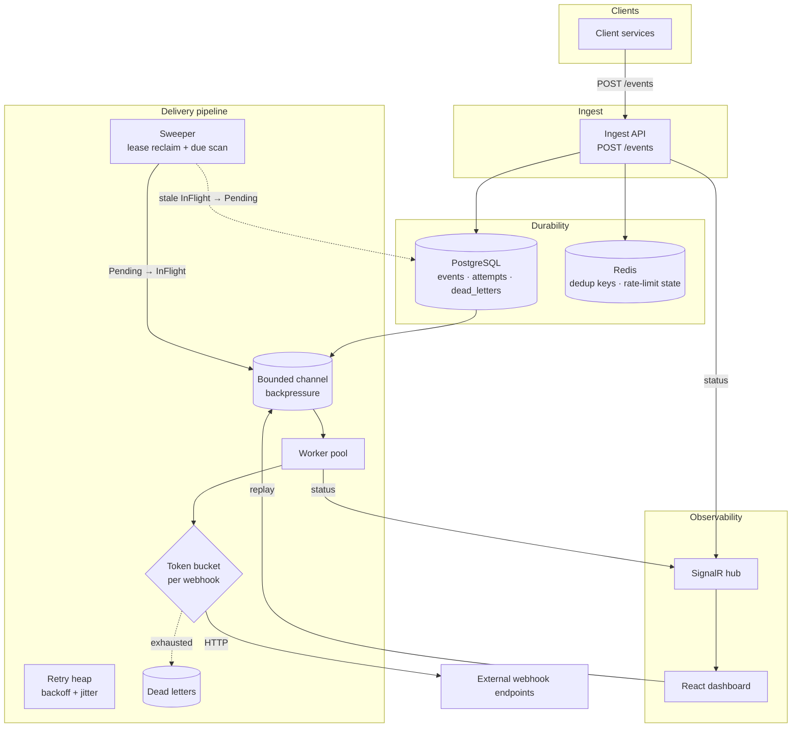
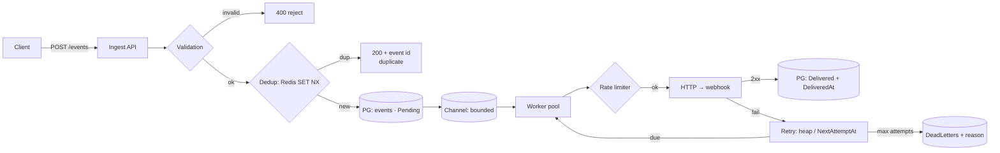
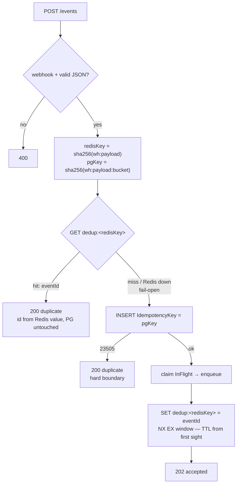
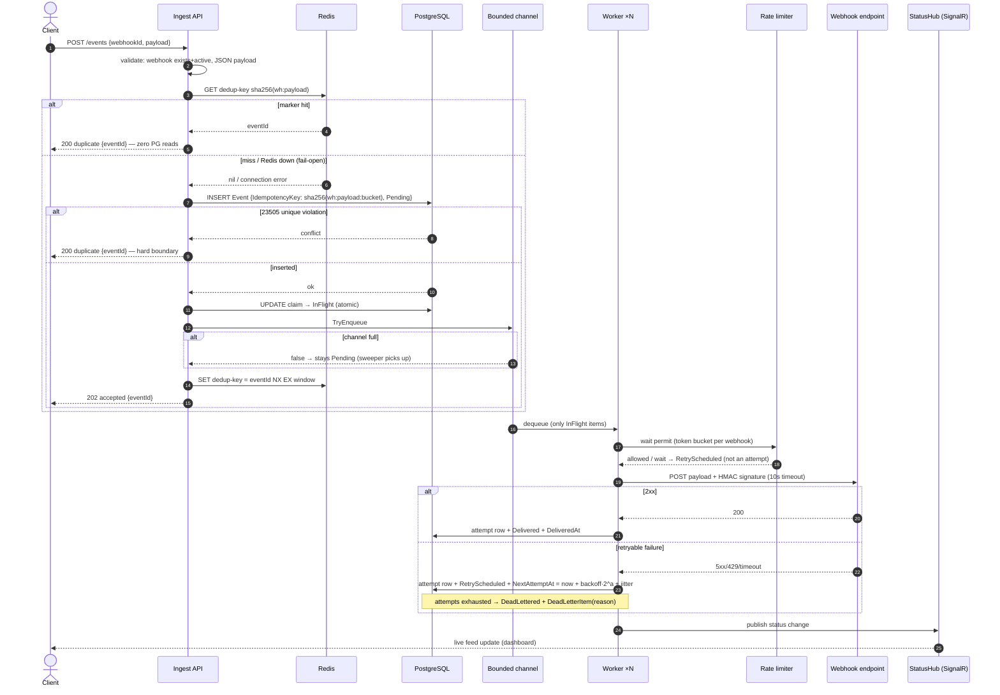
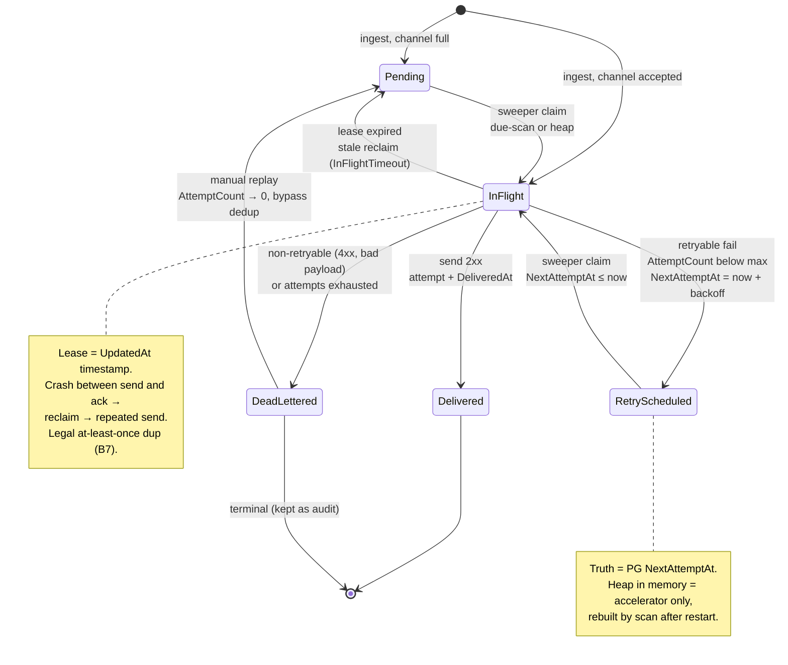
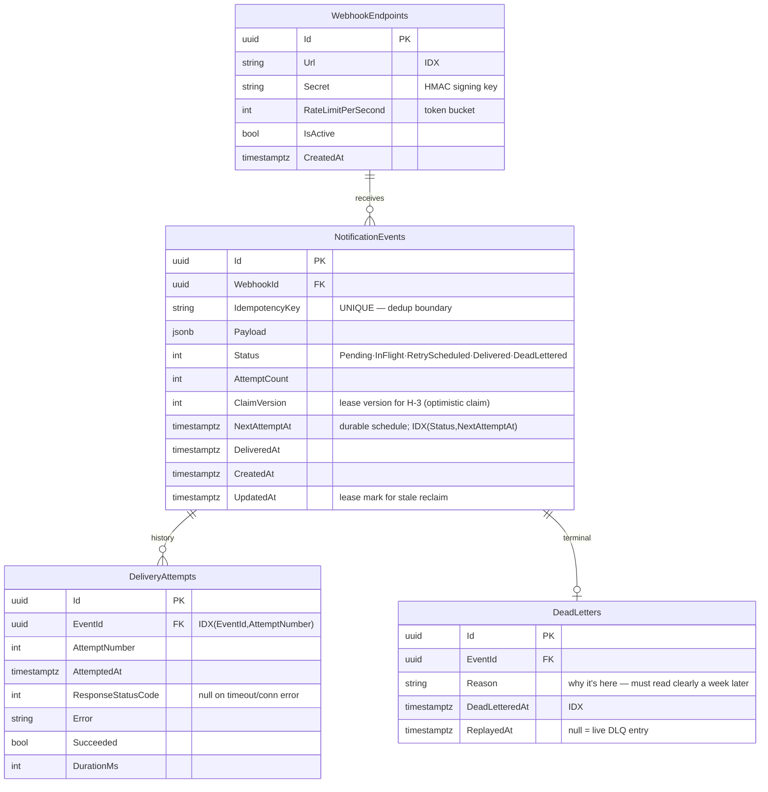

# System diagrams

Editable sources: `mmd/` — mermaid (`system.mmd` architecture,
`db.mmd` ER schema, `classes.mmd` class map, `dedup-flow.mmd` the
H-1 dedup flow, `state-machine.mmd` event statuses, `sequence.mmd`
request lifecycle); `io/` — draw.io (`system.drawio`, `db.drawio`,
`classes.drawio`); `schema.sql` — DDL. Mermaid renders directly on
GitHub; drawio opens in app.diagrams.net or the VS Code extension.

## Architecture (components)

## Data flow with failure paths

Loss zones (see [../failure-map.md](../failure-map.md) — the
dup/loss table): an event is unlosable only once it sits in `PG`.
Everything before that is either refused to the client or the
client retries itself.

## Dedup flow (H-1, rolling window)

The Redis marker is the fast path (window rolls on TTL from first
sight); the bucketed PG key is the hard window boundary (an index
can't be "by time", so time is baked into the key). Residual
degradation: Redis dead + two POSTs on opposite sides of the bucket
edge → both insert — a legal duplicate.

## Request lifecycle (sequence)

## Status machine (`EventStatus`)

## Database schema (ER)

Schema notes:
- `IdempotencyKey` UNIQUE — the last correctness boundary (Redis
  fail-open → the index decides). H-1: the key carries the time
  bucket — unique holds the window, not eternity.
- `(Status, NextAttemptAt)` — feeds the sweeper's due-scan; resolved
  by EXPLAIN (TASK-010) — full index kept, partial not needed.
- `UpdatedAt` — both lease and "when something was touched" —
  a double role.
- `ClaimVersion` — the H-3 column: claim increments it, a worker
  writes its result only under its own version (stale-claim guard).
