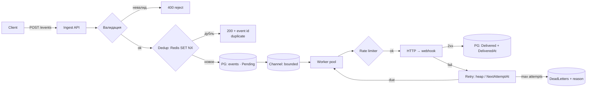
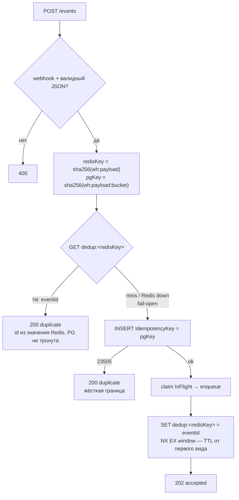
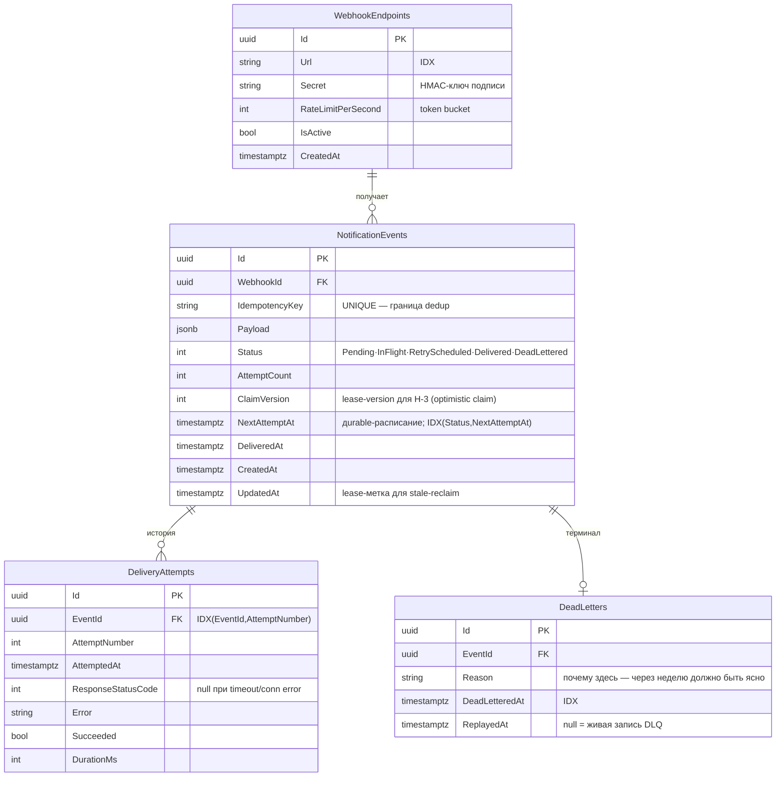

# Диаграммы системы

Файлы-источники (редактируемые): `mmd/` — mermaid (`system.mmd`
архитектура, `db.mmd` ER-схема, `classes.mmd` карта классов,
`dedup-flow.mmd` поток дедупликации H-1); `io/` —
draw.io (`system.drawio`, `db.drawio`, `classes.drawio`); `schema.sql`
— DDL. Mermaid рендерится прямо на GitHub; drawio открывается в
app.diagrams.net или расширением VS Code.

## Архитектура (компоненты)

## Data flow с путями сбоев

Красные зоны потери (см. `PLAN.md` — карта «дубль/потеря»):
событие непотеряемо только после записи в `PG`. Всё, что до неё —
либо отвергнуто клиенту, либо клиент ретраит сам.

## Dedup-поток (H-1, rolling-окно)

Redis-маркер — быстрый путь (окно катится TTL от первого вида);
бакетный PG-ключ — жёсткая граница окна (индекс не умеет «по времени»,
время зашито в ключ). Остаточная деградация: Redis мёртв + два POST'а
по разные стороны стыка бакета → оба вставятся — легальный дубль.

## Схема БД (ER)

Заметки по схеме:
- `IdempotencyKey` UNIQUE — последняя граница правильности (Redis
  fail-open → индекс решает). H-1: ключ несёт бакет времени —
  unique держит окно, а не вечность.
- `(Status, NextAttemptAt)` — кормит due-scan sweeper'а; L4 решён
  EXPLAIN'ом (TASK-010) — полный индекс держим, partial не нужен.
- `UpdatedAt` — и lease, и «когда что-то трогали» — двойная роль.
- `ClaimVersion` — колонка под H-3: claim инкрементит её, воркер
  пишет результат только под своей версией (stale-claim guard).
